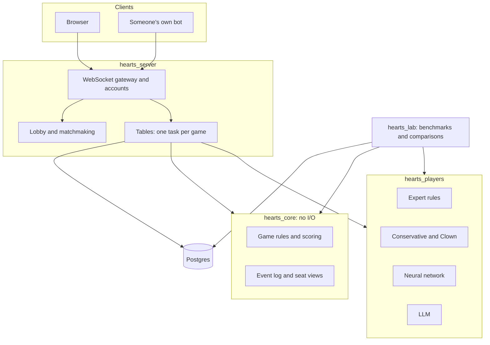

# HEARTS in Python: a design

A proposal to rebuild HEARTS in Python, as a hosted game anyone can join and as a much faster base for
experiments. Medley stays as the historical system and as the reference that the port must match.
[Mockups](mockups/index.html) show the lobby, a study table and a deal review.

## Why build it

- **Experiments are slow.** Medley plays about one deal a second, so each test of a rule change on 1,000 deals takes
  about 25 minutes. Some questions can't be asked at all: the Expert can't easily be asked about a position it
  didn't reach itself.
- **Nobody else can play.** Playing needs Medley installed, on one machine, with one game at a time.
- **People are the missing test.** Every strength number so far is one seat against three identical Experts. Real
  players would show whether the network's advantage survives, and where rules fail.

## The decisions

| Decision | Choice | Why |
|---|---|---|
| The Expert's rules | Port them as explicit rules, in Python, one-to-one | They are what's interesting, and the talk's thesis depends on being able to read and edit them |
| How to trust the port | Every Medley game is a test: same cards, same reasons | The Expert is deterministic on fixed deals, so any mismatch is a bug |
| The game's authority | The server holds all game state and sends each client only its seat's view | A client can't cheat by reading memory, and no game logic is duplicated |
| Game records | Each game is an append-only list of events | Replay, reconnection, review and research all read the same record |
| Live connection | WebSockets, one per client | Moves must arrive immediately in both directions |
| User interface | React with TypeScript, with no game logic | Cards can animate as real objects, and it works well on phones |
| First deployment | One container and one managed Postgres | Enough to learn from; the design leaves room to split later |

## Architecture

### `hearts_core`: the game, with no I/O

The rules from [ARCHITECTURE.md](../../ARCHITECTURE.md), which [selfplay/hearts_sim.py](../../selfplay/hearts_sim.py)
already implements and tests against Medley logs. It is pure and seeded, so a game can be replayed from its events.
Unlike the 1986 game loop, it validates every card it receives.

### `hearts_players`: the six messages

The 1986 protocol survives as the player interface, because it is still the right design: `GiveHand`, `PassOut`, `PassIn`,
`Play`, `Trick` and `Results`. The 1986 transports map directly:

| 1986 | Now |
|---|---|
| `Lisp` | A Python player in the same process |
| `Kee` | The Expert's rule engine |
| `Net` | A remote client over a WebSocket, whether a person or someone's own bot |

Two additions matter for research:

- **`decide(view)`.** Each automated player can answer from a complete seat view, rebuilding any memory it needs.
  So any player can be asked about any position, which is what the differential analysis wanted and Medley made
  hard.
- **`Thought`.** Each decision can return its reason: the rule and its text for the Expert, the preferences for the
  network, the explanation for an LLM.

### The Expert

This is the riskiest part. The 97 rules and the KEE-on-LOOPS layer ([medley/keeloops.lisp](../../medley/keeloops.lisp),
[medley/expert-kb.lisp](../../medley/expert-kb.lisp)) become a small Python engine with rules as data: weight-ordered
classes, first match wins, opponent models with certainties, and a record of what fired. Rules stay explicit, so variants
like `x-sr-plus` become short overlays and can be read side by side.

The 1986 report's section 3.3 argued for turning rules into procedures for speed. I'd keep them as rules, because the
rule base is the object of study here.

**The conformance test:** run the Expert in Medley on the 6,000 fixed deals, logging every seat's card and reason, and
require the Python Expert to match all of them. That needs a small change to the trace, which records only seat 1's
reasons today. Hard cases will be backward chaining through the KEE layer and the order in which opponent-model
rules update.

### `hearts_lab`: experiments

Everything in [bench/](../../bench/) and [selfplay/](../../selfplay/), with the same fixed deals and the same held-out
discipline. New abilities follow from the design:

- A hybrid seat and constraint propagation become ordinary Python, with no need for `ADVISE`.
- Mixed tables and tournaments are cheap, which tests whether a gain depends on the opponents being Experts.
- Training can use the real Expert as an opponent, which it never could.
- Games with people become data, with their consent.

The speed gain has to be measured. I'd expect it to be large, but the target to check against the Expert's current 1.3
seconds a deal is at least 100 times faster on one core.

### `hearts_server`: tables and matchmaking

- **A table** is one asyncio task, which owns its game and writes each event before announcing it. After a restart,
  tables rebuild by replaying their events.
- **Compute-heavy players** run in a worker pool, so the Expert's thinking doesn't stall other tables. LLM seats are I/O and
  stay in the event loop, with a budget.
- **Timeouts:** each move has a time limit. When it runs out, the Conservative plays that card and the game says so. A
  player who leaves can return and catch up from the event log.
- **Matchmaking** starts simple: quick play fills seats with people, and after a set wait, with chosen bots. Invitation links
  make private tables.
- **Rating** uses a Bayesian multiplayer method such as OpenSkill. Bots are rated like anyone else, which gives a new
  and more useful strength measure than one seat against three Experts.
- **Scaling later:** route each table to one process by its ID, with Redis for messages between processes. Nothing before
  that needs it.

### What each client can see

The server builds a view per seat. It never sends another player's cards, and a card is only revealed when played.

**Thoughts leak hands.** "Shooting" tells the table what you're doing, and "Leading my singleton club" tells them your
hand. So thoughts are shown to everyone only at study tables, which are unrated, and otherwise only in review after the
deal. The 1986 windows had this leak too.

### The user interface

The client is React with TypeScript, built with Vite and served as static files. Everything else is Python.

- **It stays thin.** The server sends each seat's view, including which cards are legal, and the client draws it and sends
  back choices. Hearts' rules live only in `hearts_core`, so the client never decides anything about the game.
- **One definition of the messages.** The server's event and view types are Pydantic models, and the TypeScript types are
  generated from their JSON Schema, so a change that breaks the client fails at build time.
- **State follows the event stream.** A small store applies each event from the WebSocket. Reconnecting is the same code:
  the client asks for the events it missed and applies them in order.
- **Animation is where React earns its place.** Cards can move as real objects: dealt, passed, played to the trick and swept to
  the winner, with [Motion](https://motion.dev) doing shared-layout transitions. Events queue so that three bots
  playing at once still read one card at a time. Reduced-motion settings are respected.
- **Choosing a card should feel direct.** Tap or drag on any device, with keyboard support, and illegal cards dim with the reason
  available ("You must follow diamonds"). The highlight comes from the server's legal list.
- **Thoughts update live** at study tables, and review screens reuse the same card and seat components.

The [mockups](mockups/index.html) show the layout and look. They're static HTML, so they don't show the motion, and their CSS
and card markup would carry over as the first React components.

Tests: component tests with Vitest, and Playwright for whole games in a real browser against a server with a seeded deal.

### Hosting

A single container on a host that supports long-lived WebSockets, such as Fly.io or Render, with managed Postgres. Serverless
platforms that limit request length are a poor fit. Accounts start with guests and a sign-in provider, so no passwords are
stored. Costs still need pricing; LLM seats are the one cost that grows with play, so they need a budget, and perhaps each
person's own API key.

## The mockups

- [Lobby](mockups/lobby.html): start a game by choosing who sits in each seat, see your games, and find a table, drawn as tables
  because who's sitting where is the information.
- [Study table](mockups/table.html): your turn, with everyone's reasons in a Thoughts window. Includes the phone layout.
- [Deal review](mockups/review.html): your choices beside the network's, trick by trick.

The look comes from the project's own history: the stippled gray of the Interlisp desktop becomes the table's surface, and windows
keep square corners and inverted title bars. Otherwise it's a plain modern interface, and yellow always means you can act on
something. The Expert's 1986 reasons are shown verbatim, since "Min - dumping the maggie. Heh, heh." is the best
writing in the product.

The cards, reasons, percentages and scores are from a real game, deal 201, where the network shot the moon and the Expert took 7.
The people, game totals and time limits are samples.

## How to build it

Each step ends in something that can be checked.

| Step | What | Done when |
|---|---|---|
| 1 | `hearts_core`, Clown and Conservative | Conservative matches Medley card for card on the fixed deals |
| 2 | The Expert | All cards and reasons match Medley for every seat on 6,000 deals |
| 3 | `hearts_lab` | The benchmark tables reproduce from Python, and the speed gain is measured |
| 4 | Server, React client, one table against bots | Playable in a browser and on a phone, surviving a restart mid-game |
| 5 | Accounts, lobby, matchmaking, hosting | Strangers can find each other and play, with many tables at once under a load test |
| 6 | Ratings, reviews, LLM seats, bot API | Bots have ratings from real play |

Steps 1-3 stand alone and already serve the research, even if the hosted game never ships. Step 2 is the one that could
surprise us, so it's where to learn early.

## Questions for you

1. **Who is it for?** A public site changes moderation, privacy, and terms for using games as data. A research site for
   invited players is much simpler.
2. **Timing:** I'd start after the talk on the 11th. Step 1 could begin sooner if you'd like the speed for more experiments.
